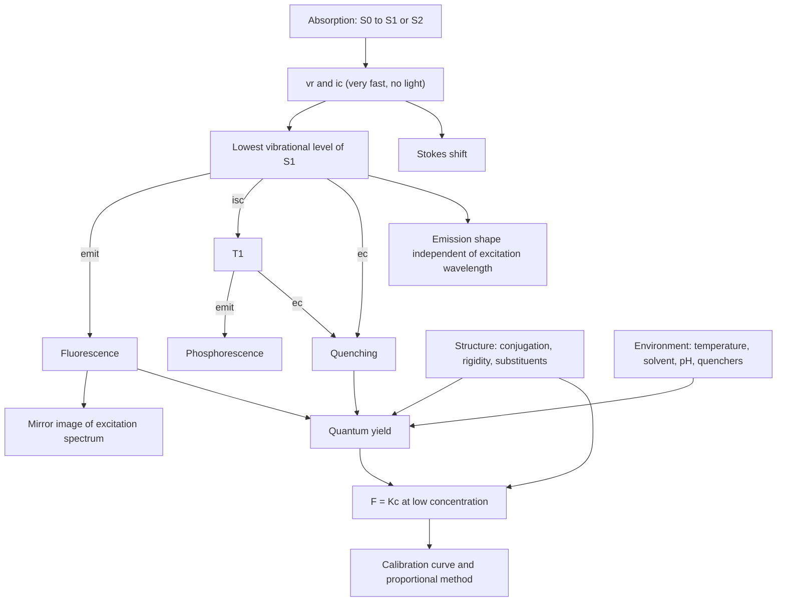

# Chapter 9 Fluorescence Analysis 荧光分析法: skeleton and term map

Source: `Chapter 9 Fluorescence Analysis荧光分析法.pdf` (78 slides, repo root). Slide numbers are given as (s12).
Notes written 2026-11-10. Anything not on the slides is marked "added".

## The chapter in one sentence

A molecule absorbs UV-Vis light, loses a little energy without emitting, then emits the rest as light of longer wavelength. We measure that emitted light against a dark background, which makes the method about 1000 times more sensitive than UV-Vis absorption.

## Skeleton

| Section | Question it answers | Exam weight (s3) |
| --- | --- | --- |
| 1 Overview (s4–7) | What is it, and why use it? | Background |
| 2.1 Origin of fluorescence (s9–22) | Where does the light come from? | **Master** |
| 2.2 Excitation and emission spectra (s23–28) | What do the spectra look like, and why? | **Master** |
| 2.3 Structure and fluorescence (s29–42) | Which molecules fluoresce? | Familiar |
| 2.4 External factors (s43–50) | What changes the intensity? | Familiar |
| 3 Instrumentation (s51–56) | How is it measured? | Understand |
| 4 Quantitation (s57–69) | How does intensity give concentration? | Understand |
| 5 New techniques (s70–75) | What else exists? | Not required 不要求 |

Also marked not required: instrument calibration (s56), indirect methods (s67–68), multi-component mixtures (s69).

## The story in seven steps

### 1. What it is (s5–7)

- Fluorometry is an **emission** method. UV-Vis and IR are absorption methods.
- Advantages: high sensitivity (10⁻¹⁰ to 10⁻¹² g/mL), good selectivity (several parameters: λex, λem, lifetime, quantum yield), simple instrument.
- Not everything that glows is fluorescence (s7): firefly and glow stick are chemiluminescence, a luminous watch is phosphorescence, a fluorescent lamp and optical brightener are fluorescence.

### 2. Where the light comes from (s9–22)

- Ground state S₀: all electrons paired, total spin s = 0, multiplicity M = 2s + 1 = 1, a **singlet**.
- Excited state: S₁, S₂ (singlet, spins still opposite) or T₁ (**triplet**, s = 1, M = 3, one pair of parallel spins).
- Absorption S₀ → S₁ or S₂ is allowed. S₀ → T₁ is forbidden.
- The excited molecule returns to S₀ by competing pathways (de-excitation 去活化):

| Pathway | What happens | Time (s22) | Emits light? |
| --- | --- | --- | --- |
| Vibrational relaxation, vr 振动弛豫 | Drops to the lowest vibrational level of the same electronic state | 10⁻¹² s | No |
| Internal conversion, ic 内转换 | Same multiplicity, e.g. S₂ → S₁ | 10⁻¹³ to 10⁻¹¹ s | No |
| Intersystem crossing, isc 系间跨越 | Different multiplicity, e.g. S₁ → T₁ | 10⁻¹⁰ to 10⁻⁸ s | No |
| External conversion, ec 外转换 | Energy passed to solvent or solute by collision (this is quenching) | 10⁻⁸ to 10⁻⁵ s | No |
| **Fluorescence 荧光** | S₁ (lowest vibrational level) → S₀ | 10⁻⁹ to 10⁻⁷ s | Yes |
| **Phosphorescence 磷光** | T₁ (lowest vibrational level) → S₀ | 10⁻⁴ to 10³ s | Yes, longer λ, persists after the lamp is off |

- Key point (s22): vr and ic are much faster than fluorescence. So whatever level was excited, the molecule first falls to the lowest vibrational level of S₁, and only then emits.

### 3. What the spectra look like (s23–28)

- **Excitation spectrum**: fix λem, scan λex, plot F against λex. It looks like the absorption spectrum.
- **Emission (fluorescence) spectrum**: fix λex, scan λem, plot F against λem.
- Use: identify the substance and choose the measuring wavelengths.
- Three features, each explained by step 2:
  1. **Stokes shift**: λem is always longer than λex, because energy is lost by vr and ic before emission.
  2. **Shape independent of λex**: emission always starts from the same level (lowest vibrational level of S₁).
  3. **Mirror image** of the excitation spectrum: the vibrational spacing in S₀ is similar to that in S₁. Sub-peak spacing reflects vibrational ΔE; sub-peak height reflects transition probability.

### 4. Which molecules fluoresce (s29–42)

Two parameters describe a fluorophore:

- **Lifetime τf**: time for F to fall to 1/e of its maximum. Fₜ = F₀e^(−Kt), K = 1/τf, so ln(F₀/Fₜ) = t/τf. A plot of ln(F₀/Fₜ) against t is a line of slope 1/τf. Different lifetimes allow mixtures to be analysed.
- **Quantum yield φf** (fluorescence efficiency): photons emitted / photons absorbed, between 0 and 1.

Two requirements (s33): (1) strong UV-Vis absorption, meaning a conjugated π→π* system (K band); (2) a reasonable φf, meaning a rigid planar structure.

| Structural factor | Effect | Slide example |
| --- | --- | --- |
| Longer conjugation | φf ↑, λ ↑ | benzene → naphthalene → anthracene: λex 205, 286, 356 nm; λem 278, 321, 404 nm; φf 0.11, 0.29, 0.36 |
| More rigidity | φf ↑, λ ↑ | biphenyl 0.2, fluorene 1.0; 8-hydroxyquinoline becomes strongly fluorescent as a chelate with Mg²⁺ or Al³⁺ |
| Steric hindrance (less coplanar) | φf ↓ | 1-dimethylaminonaphthalene-7-sulfonic acid 0.75, the 8-isomer 0.03; trans-stilbene fluoresces, cis-stilbene does not |
| Electron-donating groups | φf ↑, λem ↑ | —NH₂, —OH, —OCH₃, —NHR, —CN |
| Electron-withdrawing groups | φf ↓ | —COOH, —NO₂, —C=O, —NO, —SH, —NHCOCH₃, —X |
| Little effect | φf unchanged | —R, —SO₃H, —NH₃⁺ |

If the analyte fluoresces weakly, attach a **fluorogenic reagent 荧光试剂** (s39–42):

| Reagent | Reacts with |
| --- | --- |
| Fluorescamine 荧光胺 | Aliphatic and aromatic primary amines |
| o-Phthalaldehyde (OPA) | Primary amines, especially α-amino acids (not cysteine, proline, hydroxyproline) |
| Dansyl chloride 丹酰氯 | Primary and secondary amines, phenolic alkaloids |

### 5. What changes the intensity from outside (s43–50)

| Factor | Effect |
| --- | --- |
| Temperature ↑ | φf ↓ |
| Solvent polarity ↑ | φf ↑, λem ↑ |
| Solvent viscosity ↓ | φf ↓ |
| pH | Many fluorophores are weak acids or bases, so the species changes with pH. Slide example: aniline is the cation at pH < 2, the neutral molecule at pH 7–12, the anion at pH > 13. (Added: only the neutral molecule fluoresces.) |
| Quenchers 熄灭剂 | Interaction with solvent or solute lowers F. Above 1 g/L, self-quenching occurs. |
| Scattered light | Rayleigh: elastic, same λ as the incident light. Raman: inelastic, λ slightly longer or shorter; the longer-λ Raman light interferes most. |

- Removing Raman interference (s49–50): change λex. The Raman peak moves with λex, the fluorescence peak does not. Quinine sulfate emits at 448 nm with either 320 or 350 nm excitation, while the solvent Raman peak moves from 360 to 400 nm.
- Raman peak of water for λex 248, 313, 365, 405, 436 nm: 271, 350, 416, 469, 511 nm.
- Quenching is also a method: the fall in F is linear in quencher concentration, e.g. trace O₂ measured with the borate–benzoin complex (s45).

### 6. The instrument (s52–55)

Light path: xenon lamp (250–700 nm) → excitation monochromator → quartz cell → emission monochromator, at a right angle to the excitation beam → photomultiplier tube → recorder.

| Instrument | Excitation side | Emission side | Can record |
| --- | --- | --- | --- |
| Filter fluorimeter | Filter | Filter | No spectra, quantitation only |
| Filter-monochromator fluorimeter | Filter | Grating | Emission spectrum only |
| Spectrofluorimeter | Grating | Grating | Both spectra, and F at one wavelength |

### 7. From intensity to concentration (s58–66)

- F = K′(I₀ − I), and I = I₀·10^(−Ecl).
- So F = K′I₀(1 − 10^(−Ecl)) ≈ 2.3K′I₀Ecl when Ecl ≤ 0.05. Then **F = Kc**. K′ depends on φf.
- Linear only at low concentration.

| | Fluorometry | UV-Vis |
| --- | --- | --- |
| Relation | F = Kc | A = Ecl |
| Depends on | φf, absorptivity, concentration, path length | absorptivity, concentration, path length |
| What is measured | Emitted light on a weak background | Ratio of transmitted to incident light |
| Sensitivity | 10⁻¹⁰ to 10⁻¹² g/mL | 10⁻⁴ to 10⁻⁷ g/mL |

Direct methods:

1. **Calibration curve 工作曲线法**: zero the instrument, measure the blank, then the standards. Plot F = F(standard) − F(blank) against c.
2. **Proportional method 比例法**: if the curve passes through the origin, one standard is enough. Subtract the blank F₀:

   cx = cs × (Fx − F₀) / (Fs − F₀)

Worked example, aluminium in NaCl (Chinese Pharmacopoeia, s62–66):

- Principle: Al³⁺ forms a stable fluorescent complex with 8-hydroxyquinoline at pH 6.0, extracted into chloroform.
- Three solutions: sample (20.0 g NaCl), reference (2.0 mL of 2 µg/mL Al = 4 µg Al), blank.
- Measure at λex 392 nm, λem 518 nm.
- Pass if F(sample) ≤ F(reference), meaning Al ≤ 0.00002% (4 µg in 20 g).

Not required, one line each:

- Indirect methods: derivatisation, quenching method, sensitised fluorescence.
- Mixtures: choose λex or λem; otherwise use additivity of F and simultaneous equations.
- New techniques: laser-induced, synchronous (scan both with constant Δλ), time-resolved, spatially resolved, single-molecule, fluorescence immunoassay (direct and indirect).

## Terms

| Term | 中文 | Meaning |
| --- | --- | --- |
| Emission spectrometry | 发射光谱法 | Analysis based on light the sample emits |
| Singlet state, S | 单重态 | All spins paired, M = 1 |
| Triplet state, T | 三重态 | One pair of parallel spins, M = 3 |
| Multiplicity | 多重性 | M = 2s + 1 |
| Forbidden transition | 禁阻跃迁 | S₀ → T₁, changes the spin |
| De-excitation | 去活化 | Return of the excited molecule to S₀ |
| Radiative transition | 辐射跃迁 | Returns by emitting light |
| Non-radiative transition | 无辐射跃迁 | Returns without emitting light |
| Vibrational relaxation, vr | 振动弛豫 | Down the vibrational levels of one electronic state |
| Internal conversion, ic | 内转换 | Between states of the same multiplicity |
| Intersystem crossing, isc | 体系间跨越 | Between states of different multiplicity |
| External conversion, ec | 外转换 | Energy lost to solvent or solute |
| Fluorescence | 荧光 | Emission S₁ → S₀ |
| Phosphorescence | 磷光 | Emission T₁ → S₀ |
| Excitation spectrum | 激发光谱 | F against λex at fixed λem |
| Emission spectrum | 发射光谱 / 荧光光谱 | F against λem at fixed λex |
| Stokes shift | 斯托克斯位移 | λem longer than λex |
| Mirror-image relation | 镜像关系 | Emission spectrum mirrors the excitation spectrum |
| Fluorescence lifetime, τf | 荧光寿命 | Time for F to fall to 1/e |
| Quantum yield, φf | 荧光效率 / 荧光量子产率 | Photons emitted / photons absorbed |
| Rigid planar structure | 刚性平面结构 | Structural requirement for a high φf |
| Fluorogenic reagent | 荧光试剂 | Turns a weak fluorophore into a strong one |
| Quenching | 荧光熄灭 / 猝灭 | Fall in F from interaction with other molecules |
| Quencher | 荧光熄灭剂 | The species causing quenching |
| Self-quenching | 自熄灭 | Quenching by the fluorophore itself above 1 g/L |
| Rayleigh scattering | 瑞利散射 | Elastic scattering, same λ |
| Raman scattering | 拉曼散射 | Inelastic scattering, shifted λ |
| Spectrofluorimeter | 荧光分光光度计 | Two monochromators, records both spectra |
| Calibration curve method | 工作曲线法 | F against c for a series of standards |
| Proportional method | 比例法 | One standard, curve through the origin |
| Synchronous fluorometry | 同步荧光法 | Scan λex and λem together at constant Δλ |

## Links between terms

The same links in words:

1. **Speed decides the pathway.** vr and ic are faster than fluorescence, so emission always starts from the lowest vibrational level of S₁. That one fact gives both the Stokes shift and the shape independence.
2. **Similar vibrational spacing in S₀ and S₁** gives the mirror image.
3. **Excitation spectrum ≈ absorption spectrum.** It tells you λex. The emission spectrum tells you λem.
4. **φf is a competition** between fluorescence and the non-radiative pathways (added framing). Heat, collisions, flexible structure and quenchers speed up the non-radiative pathways, so φf falls. Rigidity and viscosity slow them, so φf rises.
5. **Fluorescence needs two things, and each maps to one factor in F = Kc.** Conjugation gives absorption (E). Rigidity gives φf (inside K′).
6. **Fluorescence versus phosphorescence**: singlet versus triplet origin, so short versus long lifetime, so one stops with the lamp and the other persists.
7. **Singlet → triplet needs isc**, which is why phosphorescence is slower and at longer wavelength (T₁ lies below S₁).
8. **ec = quenching.** It is an interference in step 5 and a method in its own right (quenching method).
9. **Raman versus fluorescence**: the Raman peak follows λex, the fluorescence peak does not (feature 2). So changing λex separates them.
10. **Rigid chelate → practical assay**: 8-hydroxyquinoline + Al³⁺ links the rigidity rule, fluorogenic reagents and the pharmacopoeia limit test.
11. **Why more sensitive than UV-Vis**: F is measured against a dark background, while A comes from the small difference between two strong beams.
12. **Linearity limit**: F = Kc holds only when Ecl ≤ 0.05. At high concentration, self-quenching is added on top.

## Slide points to check

1. Phosphorescence time is 10⁻⁴ to 10³ s on s21 but 10⁻³ to 10⁴ s on s22. Ask which one the exam uses.
2. s38 lists —CN with the electron-donating groups. Chemically —CN withdraws electrons; the slide follows the textbook list of groups that strengthen fluorescence. The Chinese heading of the electron-withdrawing line repeats "给电子基团"; it should be 吸电子基团.
3. s59 writes "K = 2.3K′I₀Ecl". That expression is F. K = 2.3K′I₀El.
