# 实验操作与基础知识：原题与易错点

[返回目录](README.md) · [五种溶剂速查](solvent-properties.md)

整理日期：2026-11-06。共 **15 道题，14 张原图**：桌面“有机实验”8题；本次上传7题，其中最后一张截图含2题。以原题为主，文字仅调整换行和排版。原图中没有的题号、答案和个人作答不补造。

## 一、桌面“有机实验”

### L01｜原第4题：石油醚的组成（判断题）

> 石油醚的化学成分为从石油中的含有C-O键的醚类化合物。
>
> A. 对　B. 错

**我的答案：对；题库答案：错。**

原解析：石油醚为低分子量烷烃的混合物。

**易错点：**名称中的“醚”不能用来判定官能团。石油醚（petroleum ether）是烃类混合物；乙醚（diethyl ether）才具有 C–O–C 结构。石油醚有不同馏程，不能像纯乙醚一样背一个固定沸点。高校实验手册也将 petroleum ether 标为有不同沸程的溶剂，见 [McMaster：How to Find a Good Recrystallizing Solvent](https://chemistry.mcmaster.ca/~chem2o6/labmanual/expt1/exp1b-i.html)。

查看原图 L01

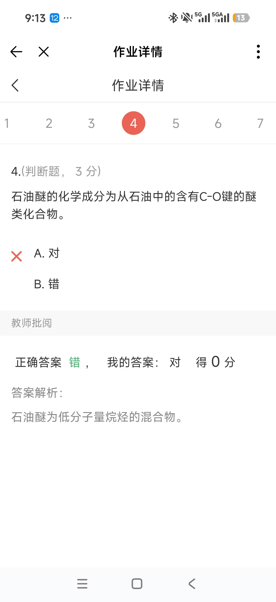

### L02｜原第18题：熔点处发生分解的标记（单选题）

> 有些化合物在加热到熔点温度时发生分解，通常表现为样品变黑或褐色。文献报道这类化合物时，常在熔点温度的右下角加上字母（　）。
>
> A. d　B. a　C. c　D. b

**截图未显示个人选择或批改结果；核对答案：A，d。**

**关键点：**d 表示 decomposition。出现分解时，应把分解现象随温度记录，不能只报一个看似正常的熔点。依据：[Rose-Hulman 有机实验手册，Melting Point，纸面第22页](https://www.rose-hulman.edu/~brandt/OrganicLab/Lab_Manual_10_Melting_Point.pdf)。

查看原图 L02

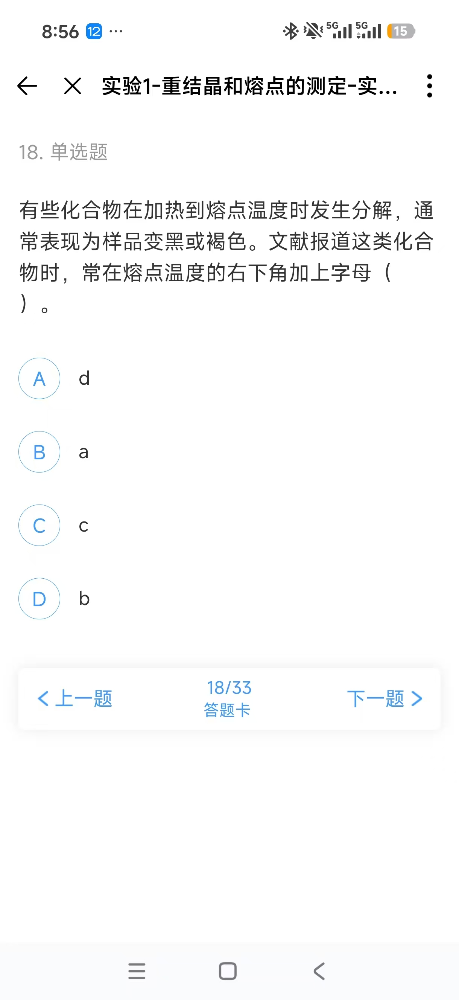

### L03｜原第20题：最不易燃的常用溶剂（单选题）

> 下列常用有机溶剂中，最不易燃的是（　）。
>
> A. 乙酸乙酯　B. 乙醚　C. 氯仿　D. 石油醚

**截图未显示个人选择或批改结果；核对答案：C，氯仿。**

**关键点：**NIOSH 将氯仿列为 noncombustible liquid。可燃性低不代表毒性低；与 [U05](#u05) 一起记。依据：[NIOSH Chloroform，Physical properties](https://www.cdc.gov/niosh/npg/npgd0127.html)。

查看原图 L03

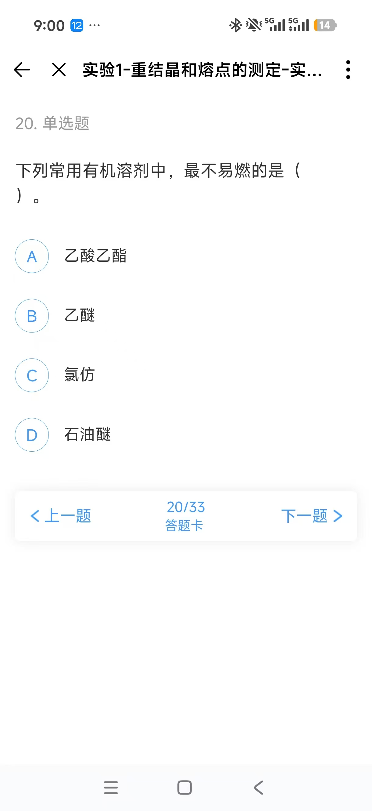

### L04｜原第22题：重结晶溶剂的沸点（单选题）

> 重结晶用的溶剂的沸点应该（　）被提纯物质的熔点。
>
> A. 低于　B. 高于　C. 等于

**截图已选：B，高于；未显示批改结果。核对答案：A，低于。**

**易错点：**常规重结晶选溶剂时，沸点一般宜低于目标固体的熔点，减少加热时目标物熔成油状液滴（oiling out）的机会，并便于除去溶剂。这是选溶剂的经验准则，不是只要满足这一项就一定能重结晶。依据：[National Taiwan University：Melting-point / Recrystallization，oiling out 部分](https://teaching.ch.ntu.edu.tw/gclab/eng/wp-content/uploads/5_M20_Melting-pointRecrystallization.pdf)。

查看原图 L04

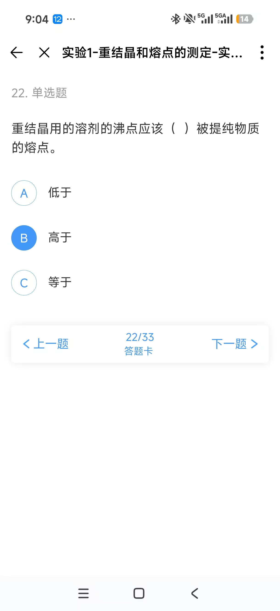

### L05｜原第26题：根据溶解性选择重结晶溶剂（单选题）

> 为对某固体化合物进行重结晶纯化，使用不同溶剂，在不同温度下进行试验，结果如下表。据此，可考虑选择（　）溶剂进行重结晶。

| 溶剂 | 室温下的溶解度 | 加热至沸腾时的溶解度 | 冷却后析出晶体的状况 |
| --- | --- | --- | --- |
| 水 | 不溶 | 少量溶解 | — |
| 乙醇 | 不溶 | 少量溶解 | — |
| 二氯甲烷 | 溶解 | 溶解 | 无晶体析出 |

> A. 乙醇–二氯甲烷混合溶剂
>
> B. 水–二氯甲烷混合溶剂
>
> C. 水
>
> D. 乙醇

**截图已选：B；未显示批改结果。核对答案：A。**

**易错点：**二氯甲烷是本题目标物的良溶剂，乙醇是较差溶剂，两者可以互溶；水与二氯甲烷不能作为这道题要求的均一混合溶剂。水或乙醇单独使用时，即使沸腾也只能少量溶解目标物。判断要同时看“溶剂之间互溶”和“目标物在其中一好一差”，不能只看后者。一般原则见 [Columbia：Recrystallization / mixed solvents](https://www.columbia.edu/cu/chemistry/ugrad/hssp/EXP_3.html)。

查看原图 L05

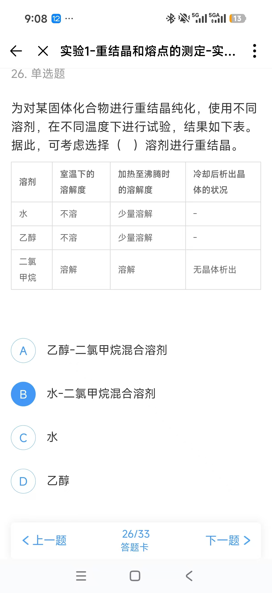

### L06｜原第29题：重结晶收率下降的原因（多选题）

> 重结晶提纯法操作不当会使收率大大下降，可能的原因有（　）。
>
> A. 结晶尚未完全时即进行抽滤
>
> B. 趁热过滤动作太慢或仪器使用不当，导致在滤纸上析出较多结晶
>
> C. 脱色时加入了过多活性炭
>
> D. 溶解时加入了过多溶剂

**我的答案：AB；题库答案：ABCD。漏选 C、D。**

| 选项 | 产物为什么损失 |
| --- | --- |
| A | 尚未析出的目标物留在母液中，随母液被分离走。 |
| B | 目标物提前在滤纸上结晶，未进入后续用于析晶的滤液。 |
| C | 活性炭不仅吸附有色杂质，过量时也会吸附目标物。 |
| D | 同一冷却温度下，更多溶剂可容纳更多溶解态目标物，留在母液中的量增加。 |

**记忆点：**“溶剂多”“活性炭多”都会损失目标物。用刚能完成热溶解的适量溶剂；必要时脱色、趁热过滤，随后冷却析晶，再收集晶体。热过滤阶段保留的是含目标物的滤液；析晶后的抽滤阶段保留的是晶体。依据：[McMaster：Some Further Points on Recrystallization](https://chemistry.mcmaster.ca/~chem2o6/labmanual/expt1/exp1b-i.html)、[University of Alberta：Recrystallization](https://www.chem.ualberta.ca/~orglabtutorials/Techniques%20Extra%20Info/Recrystallization.html)。

查看原图 L06

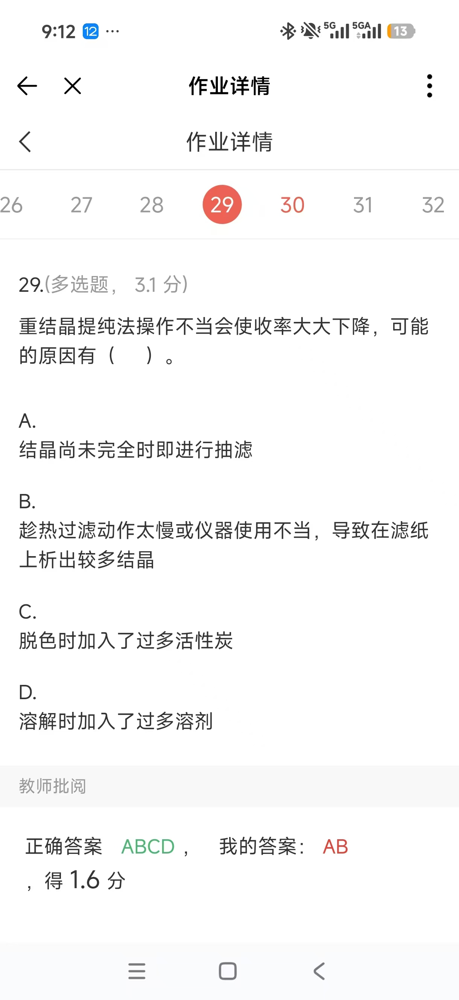

### L07｜原第30题：与水配对的混合溶剂（多选题）

> 利用混合溶剂重结晶，如果其中一种溶剂是水，则另一种溶剂只可能从下列哪种溶剂中进行选择？（　）
>
> A. 乙醇　B. 丙酮　C. 乙醚　D. 氯仿

**我的答案：AD；题库答案：AB。漏选 B，错选 D。**

原解析：如果一种溶剂是水，则另一种溶剂必须能与水互溶。

**易错点：**乙醇、丙酮与水互溶；乙醚、氯仿与水只有有限互溶性。AB 仅表示通过了本题“与水互溶”的筛选，是否适合某一具体目标物，还要检查目标物的溶解性。见 [溶剂速查](solvent-properties.md)；乙醇的互溶性见 [NIOSH Ethyl alcohol](https://www.cdc.gov/niosh/npg/npgd0262.html)。

查看原图 L07

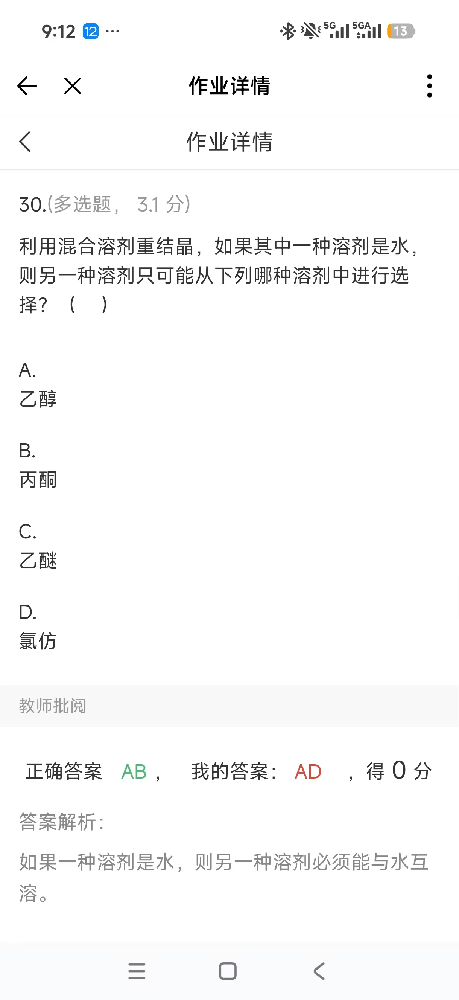

### L08｜原第33题：固体有机物的分离提纯（多选题）

> 可用于固体有机化合物的分离和提纯的常用方法包括（　）。
>
> A. 柱色谱　B. 重结晶　C. 升华　D. 萃取和洗涤

**我的答案：AB；题库答案：ABCD。漏选 C、D。**

| 方法 | 判断其能否用于固体样品的依据 |
| --- | --- |
| 柱色谱（column chromatography） | 样品可先溶解，再利用组分在固定相和流动相之间作用的差异分离。 |
| 重结晶（recrystallization） | 利用目标物与杂质的溶解性差异，以及目标物冷热溶解度差异。 |
| 升华（sublimation） | 适用于在选定条件下能升华、且有足够热稳定性的固体，与不易升华杂质分离。 |
| 萃取和洗涤（extraction / washing） | 可先将固体溶解后萃取，也可通过固–液萃取转移组分；选择性洗涤能除去表面或母液中的杂质。 |

**易错点：**原题问“可用于”，并不要求四种方法对所有固体都适用。固体样品可以在溶解后完成分离。萃取及晶体洗涤的例子见 [Columbia：Extractions / Recrystallization](https://www.columbia.edu/cu/chemistry/ugrad/hssp/EXP_3.html)。

查看原图 L08

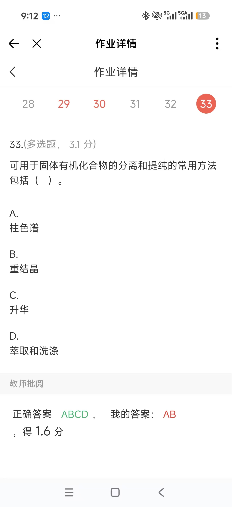

## 二、本次上传：需要注意的题

### U01｜原第15题：无机废酸、废碱的处理（判断题）

> 实验过程中产生的无机废酸液和废碱液可直接倒入无机废液桶中。
>
> A. 对　B. 错

**我的答案：对；题库答案：错。**

原解析：应先进行中和。

**记忆点与适用范围：**本题按题库记“不能直接倒入；解析要求先中和”。实际废液还要按成分和相容性分类，不能由这句话推出“任何废酸、废碱都可自行混合中和”，也不能推出“中和后即可排入下水道”。这里保留课程答案，不将其改写成通用废液处置流程。依据：[University of Illinois：Chemical Waste Procedures，Chemical Waste Segregation](https://drs.illinois.edu/Page/Waste/ChemicalWasteProcedures)。

查看原图 U01

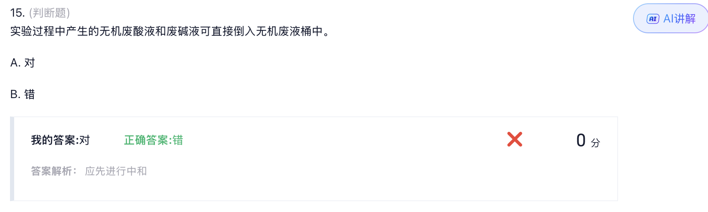

### U02｜题号被截断：金属钠与黄磷的储存（判断题）

> 〔左侧截断〕金属如金属钠应存于煤油中，黄磷则必须用水覆盖。
>
> 对 / 错（选项字母未完整显示）

**我的答案：对；题库答案：对。**

**关键点：**两个保存介质不能互换：金属钠用煤油等适宜油类隔绝空气和水分；黄磷用水覆盖以隔绝空气。题目左侧缺字，未自行补成完整原句。

查看原图 U02

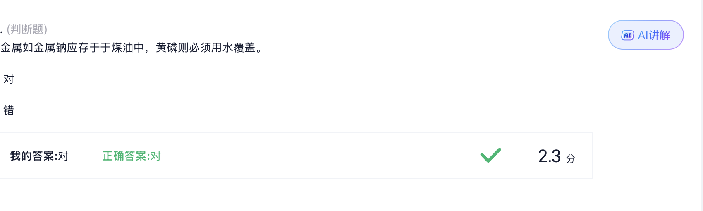

### U03｜题号未显示：有毒试剂（多选题）

> 下列哪些试剂是有毒试剂：
>
> A. 有机磷如三苯基膦
>
> B. 甲醇
>
> C. 硝基苯
>
> D. 氰化钠

**我的答案：ABCD；题库答案：ABCD。**

**关键点：**四项都要记。题目中的“有毒”是概括用语，不表示四者毒性强弱相同，也不表示所有含磷有机物具有相同危害。例如三苯基膦供应商页面列有 H302（吞咽有害）；甲醇还涉及视神经损伤。依据：[Sigma-Aldrich：Triphenylphosphine，Safety Information](https://www.sigmaaldrich.com/DO/en/product/sial/t84409)、[NIOSH：Methyl alcohol，Symptoms](https://www.cdc.gov/niosh/npg/npgd0397.html)。

查看原图 U03

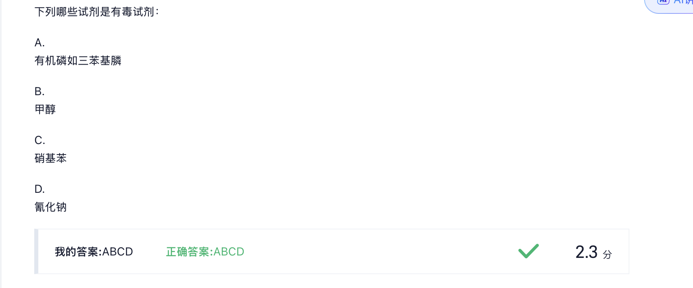

### U04｜题号未显示：易爆试剂类别（多选题）

> 下列化合物属于易爆试剂的有：
>
> A. 多硝基化合物　B. 过氧化物　C. 叠氮化物　D. 硝酸酯

**我的答案：ABCD；题库答案：ABCD。**

**关键点：**按本题记住四类；这里是危险类别的概括，不能据此断言同一类别的每个成员、任何浓度或形态都同样易爆。注意 D 是“硝酸酯”，不要记成所有“硝酸盐”。

查看原图 U04

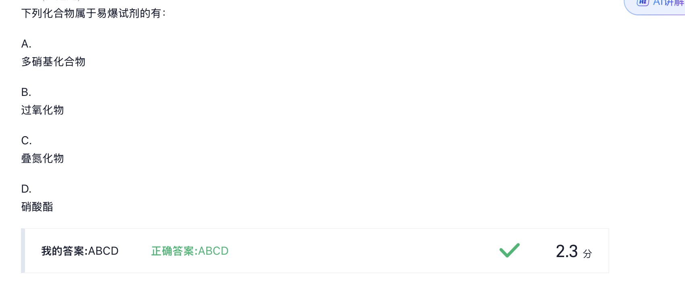

### U05｜原第37题：有机化合物的毒性比较（单选题）

> 下列有机化合物中，毒性最大的是：
>
> A. 丙酮　B. 乙酸乙酯　C. 氯仿　D. 乙醇

**我的答案：C；题库答案：C，氯仿。**

**记忆点与适用范围：**本题记氯仿。氯仿可损害肝、肾和中枢神经系统；但“毒性最大”没有指定暴露途径、剂量和毒性终点，只能作为这道题的课程答案，不宜推广为无条件排序。依据：[NIOSH Chloroform，Symptoms / Target Organs](https://www.cdc.gov/niosh/npg/npgd0127.html)。

查看原图 U05

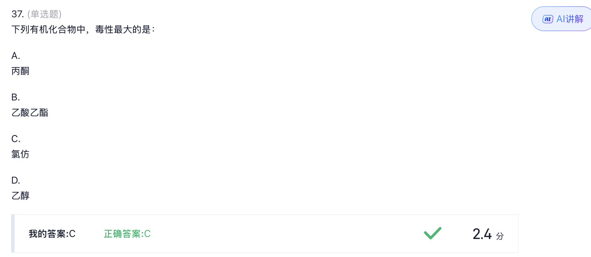

### U06｜题号被截断：通常允许的称量误差（单选题）

> 有机化学实验中，通常允许的称量误差为（　）。
>
> A. 0.1%　B. 10%　C. 5%　D. 1%

**我的答案：D；题库答案：D，1%。**

**记忆点与适用范围：**1%是这道基础实验题的课程答案，不是任何称量都适用的统一要求。具体实验仍要按所需精度和样品用量选天平。例如仅按相对误差1%估算，称取1.00 g时对应0.01 g；这不等于“天平显示到0.01 g就保证称量误差为1%”。

查看原图 U06 / U07（同一张截图）

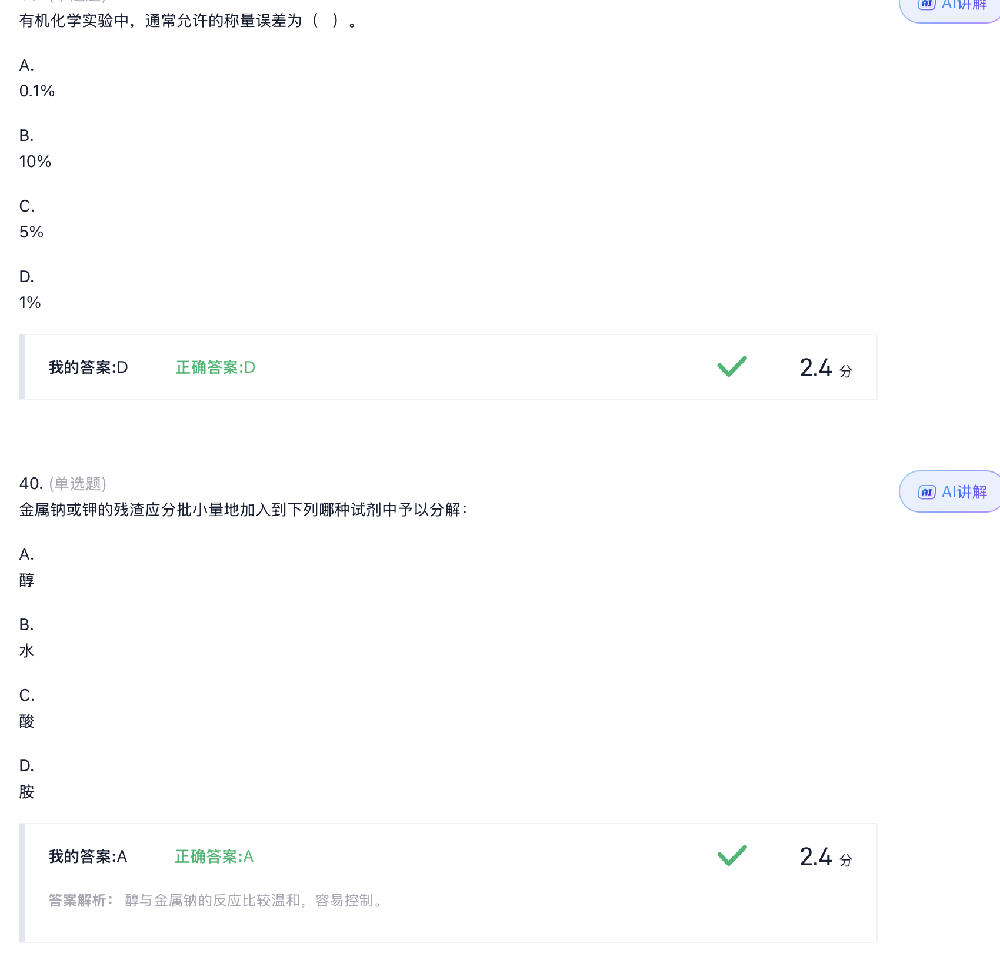

### U07｜原第40题：金属钠或钾的残渣（单选题）

> 金属钠或钾的残渣应分批小量地加入到下列哪种试剂中予以分解：
>
> A. 醇　B. 水　C. 酸　D. 胺

**我的答案：A；题库答案：A，醇。**

原解析：醇与金属钠的反应比较温和，容易控制。

**记忆点与适用范围：**本题选“醇”，并注意原解析只说了“金属钠”。钠与钾、不同醇、残渣量及表面氧化状态不能一概而论；这道选择题没有给出足以执行的残渣处理条件。实际处置应按对应金属的具体流程，而不是直接把选项扩展成“任何醇都适用”。依据：[USC Environmental Health & Safety：Quenching & Disposal](https://ehs.usc.edu/research/lab/pyrophoric-and-water-reactive-chemicals/pyrophoric-quenching/)。

[查看原图 U06 / U07](sources/U06-U07-weighing-metal-residue.png)

## 三、这批题优先纠正什么

明确有批改记录的失分点是：**L01 石油醚组成、L06 收率漏选、L07 互溶性误判、L08 提纯方法漏选、U01 废液题**。L04、L05截图选项与核对答案不符；L02、L03没有显示个人选择，作为待复习题保留。本次上传中已经答对的6题，按“需要注意的题”收录，不重复算作错题。

复习时先遮住答案重做原题，再解释每个漏选或错选选项为什么不成立。
