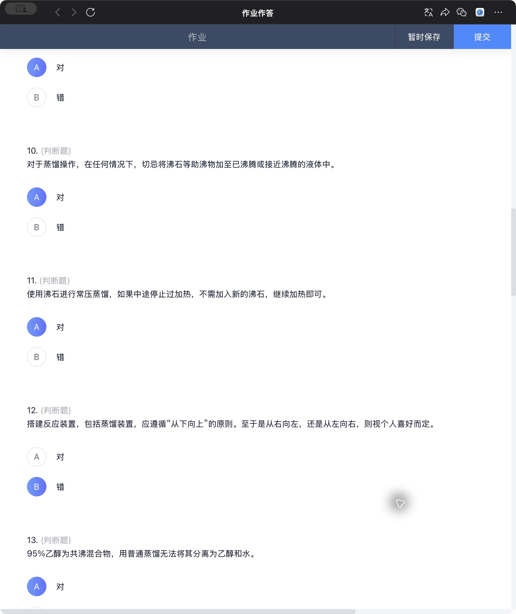
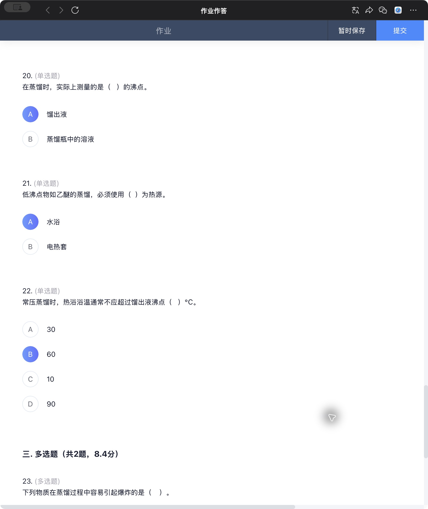

# 蒸馏与沸点测定作业核对

[返回目录](README.md) · [原始截图索引](sources/2026-11-11/README.md)

作业：**实验2 萃取、蒸馏和沸点的测定-实验后作业1**。核对日期：2026-11-11。来源为 WeCom 内的作业作答页面，共24题。

**教材核对发现2道明确错题：第11题、第22题；第12题单列待核，倾向选A，但不计入确定错题。** 其余21题未发现明确选错。页面尚未显示平台批改结果，本文“核对答案”不等于课程官方答案；保留的是检查时的原始选择，未改选或提交作业。

## 明确错题

### 第11题 中途停热后能否沿用沸石

> 使用沸石进行常压蒸馏，如果中途停止过加热，不需加入新的沸石，继续加热即可。
>
> A. 对
>
> B. 错

**原选择：A，对。核对答案：B，错。**

沸石依靠孔隙中的气体形成汽化中心，让液体持续、平稳地产生气泡。停热并冷却后，孔隙中的蒸气凝结，液体进入孔隙，原有沸石的助沸作用会减弱或失效。它虽然还在瓶中，却不能据此认定其仍有效。

因此，中断蒸馏后重新加热前，应在液体冷却后补加新的沸石。**不能向已经沸腾或接近沸腾的液体直接补加**，否则突然提供大量成核位置可能引起暴沸。这也解释了为什么第10题选“对”，而第11题必须选“错”：两题分别考查补加的时机和旧沸石是否仍可依赖。

依据：[Rose-Hulman Organic Chemistry Laboratory Manual，Distillation，印刷第46–47页，Bumping and Boiling Chips](https://www.rose-hulman.edu/~brandt/OrganicLab/Lab_Manual_16_Distillation_Theory.pdf#page=1)；[青岛科技大学《基础化学实验复习题》，印刷第11页，实验三第1题](https://hxsy.qust.edu.cn/fj/jichu.pdf)。

查看第11题原始选择及相邻题

### 第22题 热浴温度高于沸点多少

> 常压蒸馏时，热浴浴温通常不应超过馏出液沸点（　）℃。
>
> A. 30
>
> B. 60
>
> C. 10
>
> D. 90

**原选择：B，60。核对答案：A，30。**

题目问的是热浴温度与馏出液沸点的**温差上限**。常规教学要求用适度温差推动传热，通常约高出20℃，上限按本题取30℃。例如馏出液沸点为80℃，题目对应的热浴温度上限约为110℃，并非浴温只能到30℃。

温差过大，会使热量输入过快，馏出过急，增加冲料、夹带和分离不充分的可能。对于恒压下正在沸腾的纯液体，继续提高热浴温度主要会加快汽化，并不会让它的正常沸点随浴温一起升高。控制目标是平稳蒸馏，可与第16题的课程要求“1–2滴/秒”一起理解。

| 选项 | 判断理由 |
| --- | --- |
| A，30℃ | 符合本题常规热浴操作的温差上限。 |
| B，60℃ | 温差过大，不是本题要求的上限。 |
| C，10℃ | 某些条件下可能足以蒸馏，但不能据此把通常上限定为10℃。 |
| D，90℃ | 温差更大，同样不符合本题要求。 |

这里的30℃是本题的操作经验值，不是所有蒸馏装置通用的物性常数。

依据：[《有机化学》教材，蒸馏操作“5）说明”第⑤项末尾](https://mooc1.chaoxing.com/mooc-ans/ztnodedetailcontroller/visitnodedetail?_from_=&courseId=91880187&knowledgeId=91880300&rtag=)，规定热浴通常高于蒸馏液沸点不超过20℃、最高不超过30℃。

查看第22题原始选择及完整选项

## 待核题

### 第12题 装置必须从左向右搭建吗

> 搭建反应装置，包括蒸馏装置，应遵循“从下向上”的原则。至于是从右向左，还是从左向右，则视个人喜好而定。
>
> A. 对
>
> B. 错

**原选择：B，错。核对判断：倾向题目预期A；题干存在表述含糊，待课程答案确认。**

“从下向上”是先确定热源、支撑和烧瓶的位置，再连接上部仪器。左右方向则可以随装置布局调整，不能把“从左到右”当成唯一正确方向。科学出版社《有机化学实验》允许自左向右或自右向左安装；汕头大学讲义也明确允许由右向左，但限定根据实验环境决定。

因此，如果选B的理由是“任何装置都必须从左到右”，这个理由需要纠正。不过，原题说“视个人喜好而定”，省略了水电位置、操作空间、稳定支撑等条件，不能由教材允许两种方向就断言整句话无条件正确。归档时保留这道题，但不把它算作已确证的个人错题。

依据：[科学出版社《有机化学实验》，丁长江主编，印刷第8页／PDF第20页，1.3.2节第（2）–（3）点](https://www.ecsponline.com/yz/B329B4EDE22994559BB3FD7E95EB8EB01000.pdf#page=20)；[汕头大学《有机化学实验》，鲁福身、尹业高、彭蓉，第9页“蒸馏装置的安装”](https://lab.stu.edu.cn/ckeditor/userfiles/Download/HXX/20141019013031579279.pdf#page=9)。

[查看第12题完整题干、选项及原选择](sources/2026-11-11/10-q11-q12.png)。

## 全部24题核对记录

判断题A＝对，B＝错。表中“相符”指与本次教材及原理核对相符，未获得平台评分。

| 原题号 | 内容简记 | 原选择 | 核对答案或状态 |
| --- | --- | --- | --- |
| 1 | 加热时瓶底与水浴锅／电热套底部留距 | A | A，相符，按题设教学装置理解 |
| 2 | 常规有机液体蒸馏前除水干燥 | A | A，相符，按本题常规提纯情境理解 |
| 3 | 加热前加入沸石或使用搅拌磁子 | A | A，相符 |
| 4 | 为提高产率应尽量蒸干 | B | B，相符 |
| 5 | 冷凝水上进下出 | B | B，相符，应下进上出 |
| 6 | 恒定沸点必然意味着纯物质 | B | B，相符，共沸物是反例 |
| 7 | 电热套加热前擦净瓶底 | A | A，相符 |
| 8 | 先加热再通冷凝水 | B | B，相符，应先通水 |
| 9 | 甲苯共沸带水 | A | A，相符 |
| 10 | 不向沸腾或近沸液体补加沸石 | A | A，相符 |
| **11** | **停热后沿用旧沸石** | **A** | **B，明确错误** |
| **12** | **搭建装置的左右方向** | **B** | **倾向A，待核，不计入确定错误** |
| 13 | 95%乙醇与普通蒸馏的共沸限制 | A | A，按课程近似表述相符 |
| 14 | 蒸馏结束先停水再停热 | B | B，相符，应先停热，冷却后再停水 |
| 15 | 普通蒸馏适用的沸点差 | D，40℃ | D，符合本题口径，与第24题D一致 |
| 16 | 馏出速率 | B，1–2滴/秒 | B，相符 |
| 17 | 温度计圆泡位置 | C，与蒸馏头支管下沿平齐 | C，按常规圆泡上缘定位理解 |
| 18 | 待蒸馏液体的装液比例 | D，1/3–2/3 | D，符合本题口径 |
| 19 | 沸点高于140℃时的冷凝管 | A，空气冷凝管 | A，符合本题口径 |
| 20 | 蒸馏时测量谁的沸点 | A，馏出液 | A，相符，温度计感受进入冷凝管的蒸气 |
| 21 | 乙醚等低沸点物质的加热方式 | A，水浴 | A，符合本题给出的两种选项 |
| **22** | **热浴温度高于馏出液沸点的上限** | **B，60℃** | **A，30℃，明确错误** |
| 23 | 蒸馏过程中容易引起爆炸的物质 | ABCD | ABCD，未见漏选或误选 |
| 24 | 常压蒸馏的用途 | ABCD | ABCD，相符 |

第1题可参见[《基础有机化学实验教学中的操作细节——常压蒸馏教学实践经验谈》1.3节](https://www.dxhx.pku.edu.cn/article/2023/1000-8438/20230128.shtml)，该教学装置要求烧瓶与电热套之间留约1 mm。第13题的百分数未注明浓度基准，复习重点是“共沸组成处气液组成相同，普通蒸馏不能得到两个纯组分”，不要把题面的95%扩写成未经核实的精确共沸组成。第15、18、19题的数值按本题教学口径记录，不作为所有装置的统一界限。

复习优先顺序：先解释旧沸石为何在冷却后失效，再区分热浴温度与馏出液沸点，最后辨别装置搭建中的必要条件和可调整的习惯。
