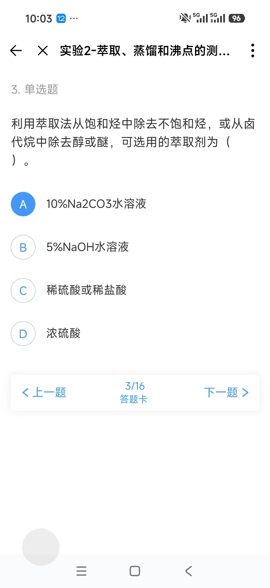
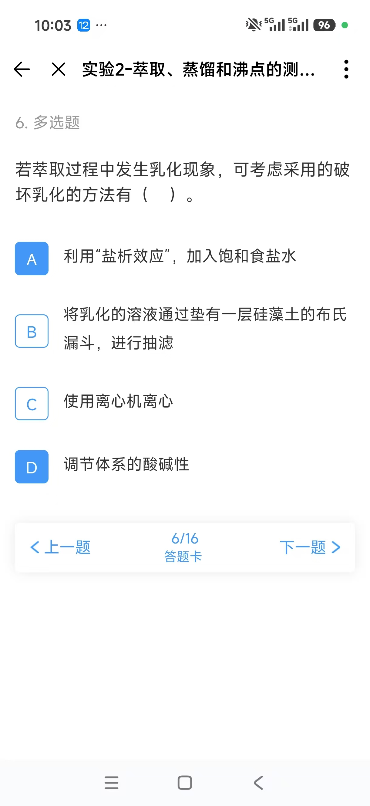
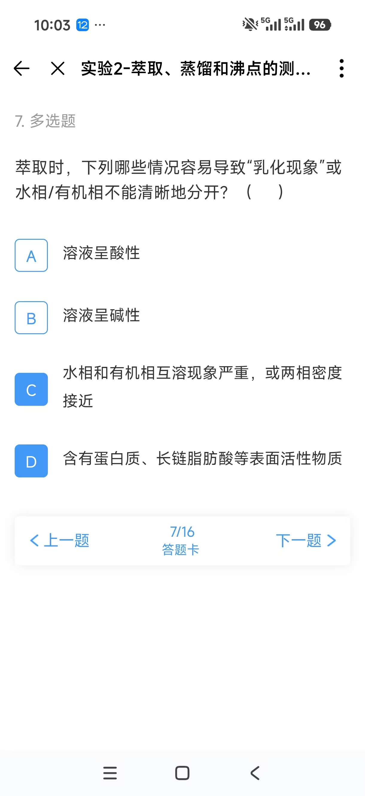

# 萃取作业第二部分错题与解析

[返回目录](README.md) · [第一部分蒸馏作业](2026-11-11-distillation-review.md) · [Nernst 分配定律](nernst-distribution-law.md) · [原图索引](sources/2026-11-11-extraction-part2/README.md)

整理日期：2026-11-11。本次收录用户提供的第二部分5道错题，保留原题号3、6、7、9、10。截图显示该部分共16题，本次未核对其余11题。**用户确认这5题的错因均为“知识不清晰”。** 图片仅显示作答状态，没有平台批改结果，以下答案标为教材核对答案。

## 核对结果

| 原题号 | 原答案 | 核对答案 | 需要补清楚的知识 |
| --- | --- | --- | --- |
| 3 | A | **D** | 不同酸碱萃取剂针对的物质不同；本题是化学萃取 |
| 6 | AD | **ABCD**，漏选B、C | 破乳既可改变化学条件，也可采用过滤、离心等物理方法 |
| 7 | CD | **BCD**，漏选B | 碱性条件可能促使表面活性物质形成；互溶、乳化、分层慢要区分 |
| 9 | ACD | **ABDE**，错选C，漏选B、E | 有机层在上还是在下，由两相密度决定 |
| 10 | B，错 | **A，对** | 普通液液萃取需要两个可分取的液相；丙酮与水互溶 |

## 第3题 选择化学萃取剂

> 利用萃取法从饱和烃中除去不饱和烃，或从卤代烷中除去醇或醚，可选用的萃取剂为（　）。
>
> A. 10%Na₂CO₃水溶液
>
> B. 5%NaOH水溶液
>
> C. 稀硫酸或稀盐酸
>
> D. 浓硫酸

**原答案A；核对答案D；错因：知识不清晰。**

这里利用的是**化学萃取**：使杂质发生质子化或其他反应，改变它在两相中的分布。浓硫酸能与不饱和烃发生加成等反应；醇、醚的氧原子可以被质子化，形成更易进入强酸相的物种。教材据此把浓硫酸列作这两类除杂问题的萃取剂。重点是识别杂质的反应性，不能只凭“某试剂是常见萃取剂”选答案。

| 选项 | 在这类题中主要针对什么 | 为什么本题选或不选 |
| --- | --- | --- |
| A，Na₂CO₃水溶液 | 能与碳酸盐反应的酸性杂质，如羧酸 | 不能把普通不饱和烃、醇和醚统一转成水溶性盐。 |
| B，NaOH水溶液 | 羧酸、酚等酸性物质 | 普通醇不能像羧酸、酚那样用NaOH水溶液有效成盐萃走；烯烃、醚也不符合这一除杂逻辑。 |
| C，稀酸 | 胺等有机碱性物质 | 不能把稀酸除胺的规则直接套到本题的醇、醚和不饱和烃。 |
| D，浓硫酸 | 本题所列不饱和烃、醇和醚杂质 | 通过反应或强酸中的质子化等作用实现选择性移除。 |

这不是说浓硫酸适合所有有机混合物；该选择成立的前提是主要保留组分在所用条件下足够稳定。

依据：[湖南科技大学《有机化学实验》讲义，PDF第84页，化学萃取段](https://hgcl.hnust.edu.cn/docs/2023-04/9c01fd25ff1947cc85e3898feacb89d8.pdf#page=84)，直接列出了题干中的两种用途。

查看第3题原图

## 第6题 破乳方法

> 若萃取过程中发生乳化现象，可考虑采用的破坏乳化的方法有（　）。
>
> A. 利用“盐析效应”，加入饱和食盐水
>
> B. 将乳化的溶液通过垫有一层硅藻土的布氏漏斗，进行抽滤
>
> C. 使用离心机离心
>
> D. 调节体系的酸碱性

**原答案AD；核对答案ABCD；漏选B、C。错因：知识不清晰。**

乳液是一种液体以细小液滴分散在另一种不相溶液体中，液滴迟迟不能聚并、分离的状态。破乳可以削弱稳定液滴的因素，也可以促进液滴分离，因此并非只有加入试剂才有效。

| 选项 | 为什么可以考虑 |
| --- | --- |
| A，饱和食盐水 | 提高水相离子强度，常能降低部分有机组分在水中的溶解度；同时改变水相密度等条件，帮助分层。 |
| B，硅藻土过滤 | 硅藻土滤层可帮助移除稳定乳液的细颗粒等物质，并促进乳液分离；这是实验手册列出的物理处理方法。 |
| C，离心 | 利用两相密度差，加快细液滴的迁移和分离。 |
| D，调节pH | 对由可电离表面活性物质稳定的乳液，改变其带电状态有时可以破乳。例如使脂肪酸盐转回中性脂肪酸。 |

题目问的是“**可考虑采用**”，并不表示四种方法对所有乳液都有效。调节pH还会改变目标物的电离及分配，必须与目标物的性质一起判断。硅藻土过滤也不能理解为“任意加入硅藻土就一定破乳”。

依据：[Columbia University，Liquid-liquid Extraction，Emulsions段](https://www.columbia.edu/cu/chemistry/ugrad/hssp/EXP_3.html)列出盐水、离心与硅藻土过滤；[湖南人文科技学院《有机化学实验》指导书，分离提纯部分“产生乳化一般原因”段](https://www.huhst.edu.cn/chxy/info/1145/2578.htm)说明条件允许时可调pH破乳。

查看第6题原图

## 第7题 乳化与不易分层的原因

> 萃取时，下列哪些情况容易导致“乳化现象”或水相/有机相不能清晰地分开？（　）
>
> A. 溶液呈酸性
>
> B. 溶液呈碱性
>
> C. 水相和有机相互溶现象严重，或两相密度接近
>
> D. 含有蛋白质、长链脂肪酸等表面活性物质

**原答案CD；核对答案BCD（按本题常规教学口径）；漏选B。错因：知识不清晰。**

| 选项 | 具体解释 |
| --- | --- |
| A，不选 | 仅知道“酸性”不能推出容易乳化。某些由脂肪酸盐稳定的乳液反而可通过酸化破坏；这不等于所有酸性体系都不会乳化。 |
| B，选 | 如果混合物含长链脂肪酸，碱可使其转为具有表面活性的羧酸盐，即皂类物质，帮助稳定细液滴。碱性洗涤因此可能更易乳化；不是任何碱液都会乳化。 |
| C，选 | 密度差小会减慢液滴上浮或沉降，使分层变慢；较强互溶也可能影响两相的形成和可分取性。题干把“乳化”和“不能清晰分开”并列，因此本项可选。 |
| D，选 | 蛋白质、长链脂肪酸及其盐等可在界面吸附，阻碍液滴聚并，使乳液更稳定；具体作用随组成和pH而变化。 |

**必须区分：乳化仍存在两个液相，只是其中一相分散成小液滴；完全互溶形成的是均一液相；密度接近主要解释分层慢。** 三者都可能妨碍分液，但原因不同。

依据：[青岛科技大学《有机化学参数手册》，“乳化现象解决的方法”第（2）–（3）点](https://hxsy.qust.edu.cn/info/1065/1452.htm)；[湖南人文科技学院指导书，乳化原因与pH处理段](https://www.huhst.edu.cn/chxy/info/1145/2578.htm)。

查看第7题原图

## 第9题 有机层在上层还是下层

> 分别用下列溶剂萃取水溶液中的有机物，分液后，有机相在上层的有：
>
> A. 乙醚
>
> B. 甲苯
>
> C. 二氯甲烷
>
> D. 石油醚
>
> E. 乙酸乙酯
>
> F. 氯仿

**原答案ACD；核对答案ABDE；错选C，漏选B、E。错因：知识不清晰。**

先确认体系形成两个液相，再比较两相的密度：密度小的一相在上层。不能把“有机层”直接等同于“上层”，也不能用极性大小判断上下位置。

| 选项 | 纯溶剂相对密度的复习近似值 | 通常水相中的层位 |
| --- | --- | --- |
| A，乙醚 | 约0.71 | 上层，选 |
| B，甲苯 | 约0.87 | 上层，选 |
| C，二氯甲烷 | 约1.33 | 下层，不选 |
| D，石油醚 | 小于1；为烃类混合物，随馏分变化 | 上层，选 |
| E，乙酸乙酯 | 约0.90 | 上层，选 |
| F，氯仿 | 约1.48 | 下层，不选 |

表中相对密度没有单位，以水约为1作比较。实际比较的是**两相溶液**的密度，纯溶剂数据用于本题的通常稀溶液判断。

相对密度依据NIOSH的Specific Gravity项：[乙醚](https://www.cdc.gov/niosh/npg/npgd0277.html)、[甲苯](https://www.cdc.gov/niosh/npg/npgd0619.html)、[二氯甲烷](https://www.cdc.gov/niosh/npg/npgd0414.html)、[乙酸乙酯](https://www.cdc.gov/niosh/npg/npgd0260.html)、[氯仿](https://www.cdc.gov/niosh/npg/npgd0127.html)。二氯甲烷和氯仿位于通常水相下方的判断也见[Columbia实验手册，溶剂分层段](https://www.columbia.edu/cu/chemistry/ugrad/hssp/EXP_3.html)。

查看第9题原图

## 第10题 丙酮能否作为水相液液萃取剂

> 不能用丙酮来萃取水相中的有机物。
>
> A. 对
>
> B. 错

**原答案B，错；核对答案A，对（普通液液萃取语境）。错因：知识不清晰。**

普通液液萃取需要目标物在两个可以分取的液相间分配。丙酮虽然能溶解许多有机物，但与水互溶，直接加入水相通常得到一个液相，不能像乙醚或二氯甲烷那样得到可分取的独立有机层。

所以，选择萃取剂要同时问：“能否溶解目标物？”和“能否与原溶剂形成可分取的两相？”只满足前者不够。此题不讨论另加盐或改变组成而诱导分相的特殊体系。

依据：[NIOSH Acetone，Solubility项：Miscible](https://www.cdc.gov/niosh/npg/npgd0004.html)。这与[Nernst分配定律](nernst-distribution-law.md)要求存在两个平衡液相相衔接。

查看第10题原图

## 这组知识如何连起来

**能否形成两相，看互溶性；上下层位置，看密度；某一物种在两相中的浓度比，看分配平衡；酸碱或其他反应改变物种后，要重新考虑总分配。** 乳化主要妨碍两相顺利分开，不能直接用“目标物更喜欢哪个溶剂”解释。

复习时遮住答案，分别解释第3题为什么不能选稀酸、第6题为何过滤与离心也可破乳、第7题为何碱性只是条件性因素、第9题为何二氯甲烷在下、第10题为何“能溶解”仍不够。
